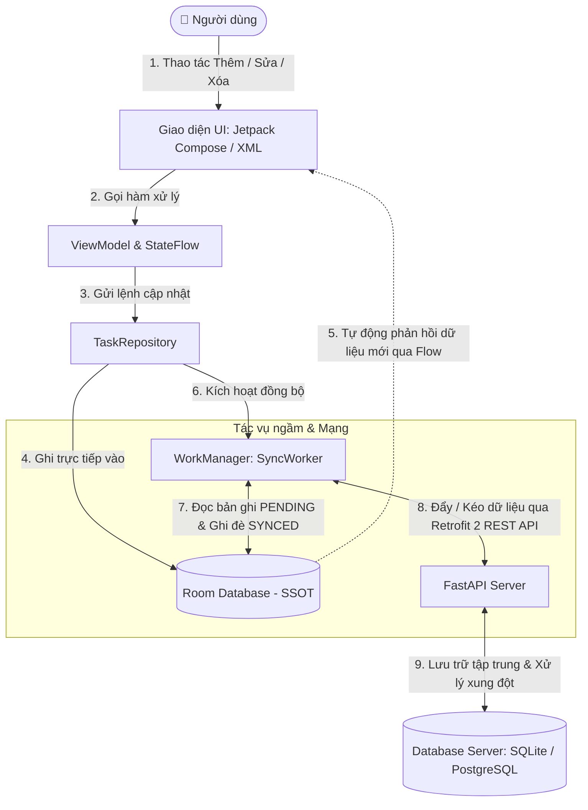
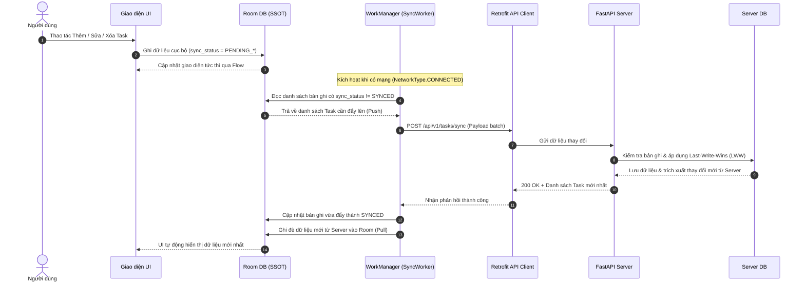

# 📱 BÁO CÁO KỸ THUẬT & TÀI LIỆU DỰ ÁN GIỮA KỲ
## ỨNG DỤNG ANDROID OFFLINE-FIRST VỚI FASTAPI BACKEND

> **Môn học:** Lập trình Thiết bị Di động (Mobile Programming)  
> **Kiến trúc trọng tâm:** Offline-First Architecture • Single Source of Truth (SSOT) • Two-Way Sync Engine • Last-Write-Wins (LWW)  
> **Nền tảng công nghệ:** Android (Kotlin, Jetpack Compose/XML, Room DB, WorkManager, Retrofit 2) & Backend (Python FastAPI, SQLAlchemy, SQLite/PostgreSQL)

---

## 👥 THÔNG TIN NHÓM THỰC HIỆN

| STT | Họ và Tên | Mã số sinh viên (MSSV) | Vai trò chính | Phụ trách chi tiết |
| :-: | :--- | :--- | :--- | :--- |
| **1** | [Họ và Tên Thành viên A] | [MSSV A] | **Android Lead & UI/UX** | UI/UX, Room DB, ViewModel, StateFlow, Bàn giao D1, D2, D8 |
| **2** | [Họ và Tên Thành viên B] | [MSSV B] | **Backend & Sync Engine** | FastAPI Server, WorkManager, Retrofit 2, Bàn giao D4, D5, D6, D7 |

---

## 📑 MỤC LỤC
1. [Tổng quan Kiến trúc Hệ thống](#1-tổng-quan-kiến-trúc-hệ-thống)
2. [Quy ước Dữ liệu Dùng chung (Data Contract)](#2-quy-ước-dữ-liệu-dùng-chung-data-contract)
3. [Thiết kế Backend API (Python FastAPI)](#3-thiết-kế-backend-api-python-fastapi)
4. [Cấu trúc Thư mục Dự án](#4-cấu-trúc-thư-mục-dự-án)
5. [Phân chia Nhiệm vụ & Danh mục Bàn giao (Deliverables)](#5-phân-chia-nhiệm-vụ--danh-mục-bàn-giao-deliverables)
6. [Kịch bản Kiểm thử Thực nghiệm (Test Cases TC01 - TC09)](#6-kịch-bản-kiểm-thử-thực-nghiệm-test-cases-tc01---tc09)
7. [Hướng dẫn Cài đặt & Chạy Thực nghiệm](#7-hướng-dẫn-cài-đặt--chạy-thực-nghiệm)

---

## 1. TỔNG QUAN KIẾN TRÚC HỆ THỐNG

Dự án áp dụng chặt chẽ triết lý **Offline-First Architecture**. Trong mô hình này:
- Cơ sở dữ liệu cục bộ (**Room Database**) trên thiết bị đóng vai trò là nguồn dữ liệu duy nhất (**Single Source of Truth - SSOT**) mà giao diện người dùng (UI) quan sát và hiển thị.
- Mọi thao tác Thêm / Sửa / Xóa từ người dùng đều được ghi nhận trực tiếp vào Room DB ngay lập tức mà **không cần chờ kết nối Internet**.
- Tiến trình nền (**WorkManager - SyncWorker**) chịu trách nhiệm đồng bộ hai chiều (Two-Way Sync) giữa Room DB và FastAPI Server khi đáp ứng đủ điều kiện về kết nối mạng (`NetworkType.CONNECTED`).

### 1.1. Sơ đồ Luồng Dữ liệu Kiến trúc (Data Flowchart)



### 1.2. Sơ đồ Trình tự Đồng bộ Hai chiều (Sync Sequence Diagram)



---

## 2. QUY ƯỚC DỮ LIỆU DÙNG CHUNG (DATA CONTRACT)

Để quá trình đồng bộ hai chiều diễn ra an toàn, không xảy ra xung đột khóa chính khi tạo mới ngoại tuyến, hệ thống thống nhất cấu trúc dữ liệu chung:

### 2.1. Bảng Đặc tả Thuộc tính Bản ghi (Task Schema)

| Tên trường | Kiểu dữ liệu | Phạm vi | Mô tả chi tiết |
| :--- | :--- | :--- | :--- |
| `id` | `String (UUID v4)` | Client & Server | Khóa chính dạng chuỗi UUID do Client sinh ngẫu nhiên khi tạo bản ghi mới (tránh trùng ID khi Offline). |
| `title` | `String` | Client & Server | Tiêu đề công việc (bắt buộc, độ dài tối đa 255 ký tự). |
| `description` | `String?` | Client & Server | Mô tả chi tiết công việc (cho phép `null` / rỗng). |
| `is_completed` | `Boolean` | Client & Server | Trạng thái hoàn thành (`true`: đã xong, `false`: chưa xong). Mặc định `false`. |
| `created_at` | `Long (Unix ms)` | Client & Server | Mốc thời gian tạo bản ghi ban đầu (milliseconds). |
| `updated_at` | `Long (Unix ms)` | Client & Server | Mốc thời gian chỉnh sửa mới nhất (milliseconds) để phân giải xung đột (**Last-Write-Wins**). |
| `is_deleted` | `Boolean` | Client & Server | Cờ xóa logic (**Soft Delete**). Không xóa vật lý để Server và các thiết bị khác nhận diện lệnh xóa. |
| `sync_status` | `String / Enum` | **Chỉ có ở Room DB** | Trạng thái đồng bộ cục bộ: `SYNCED`, `PENDING_INSERT`, `PENDING_UPDATE`, `PENDING_DELETE`, `FAILED`. |

### 2.2. Chi tiết Cơ chế Xử lý Cốt lõi
1. **Client-Generated UUID (UUID v4):**
   - Tránh việc phụ thuộc vào `Auto-Increment ID` của Server.
   - Cho phép thiết bị tạo hàng loạt công việc ngoại tuyến mà không sợ đụng độ ID với các máy khác.
2. **Soft Delete (`is_deleted = true`):**
   - Khi người dùng xóa task ngoại tuyến, bản ghi không bị `DELETE` khỏi database mà được gán `is_deleted = true`, `sync_status = PENDING_DELETE`.
   - Khi có mạng, cờ này được gửi lên Server để Server cập nhật trạng thái xóa tương ứng.
3. **Last-Write-Wins (LWW Conflict Resolution):**
   - Trong trường hợp cùng một bản ghi được chỉnh sửa trên 2 thiết bị khác nhau khi offline, bản ghi nào có `updated_at` lớn hơn (chỉnh sửa muộn hơn theo mốc thời gian) sẽ được ghi nhận là bản ghi chiến thắng.

---

## 3. THIẾT KẾ BACKEND (PYTHON FASTAPI)

FastAPI đóng vai trò là Server trung tâm, cung cấp các RESTful API phục vụ đồng bộ lô (Batch Sync) và truy vấn dữ liệu tăng dần (Incremental Fetch).

### 3.1. Danh sách Endpoints RESTful

| Phương thức | Endpoint | Chức năng chính | Ghi chú |
| :--- | :--- | :--- | :--- |
| `GET` | `/api/v1/health` | Kiểm tra tình trạng hoạt động của Server | Dùng để ping trước khi thực hiện tác vụ nặng |
| `GET` | `/api/v1/tasks` | Tải danh sách công việc | Hỗ trợ Query Param `since_timestamp` để lấy dữ liệu tăng dần |
| `POST` | `/api/v1/tasks/sync` | API Đồng bộ lô (Batch Sync & Conflict Resolution) | Nhận danh sách thay đổi từ Client và trả về danh sách cập nhật từ Server |

### 3.2. Chi tiết Đặc tả API & Payload Mẫu

#### 🟢 `GET /api/v1/health`
- **Mục đích:** Healthcheck kiểm tra kết nối Server.
- **Response `200 OK`:**
```json
{
  "status": "healthy",
  "server_time": 1729605600000
}
```

---

#### 🔵 `GET /api/v1/tasks`
- **Mục đích:** Tải danh sách công việc (hỗ trợ đồng bộ tăng dần).
- **Query Parameters:**
  - `since_timestamp` *(Long, tùy chọn)*: Thời điểm đồng bộ lần cuối (Unix timestamp ms).
- **Quy tắc xử lý:**
  - Không truyền `since_timestamp`: Trả về toàn bộ bản ghi chưa xóa (`is_deleted == false`).
  - Có truyền `since_timestamp`: Trả về tất cả bản ghi có `updated_at > since_timestamp` (bao gồm cả các bản ghi có `is_deleted == true` để Client xóa tương ứng).
- **Response `200 OK`:**
```json
[
  {
    "id": "c3a7266b-4e12-4217-b715-d9e26efbbba9",
    "title": "Hoàn thành báo cáo Giữa kỳ",
    "description": "Viết tài liệu D1 đến D8",
    "is_completed": false,
    "updated_at": 1729605700000,
    "is_deleted": false
  }
]
```

---

#### 🟠 `POST /api/v1/tasks/sync` (Trọng tâm Đề tài)
- **Mục đích:** Đẩy danh sách các thay đổi từ Client lên và giải quyết xung đột bằng chiến lược **Last-Write-Wins (LWW)**.
- **Request Body:**
```json
{
  "client_last_sync_timestamp": 1729605000000,
  "tasks": [
    {
      "id": "c3a7266b-4e12-4217-b715-d9e26efbbba9",
      "title": "Hoàn thành báo cáo Giữa kỳ (Updated)",
      "description": "Đã hoàn thành sơ đồ Mermaid",
      "is_completed": true,
      "updated_at": 1729605800000,
      "is_deleted": false
    }
  ]
}
```
- **Thuật toán xử lý trên Server:**
  1. Duyệt qua từng bản ghi trong danh sách `tasks` Client gửi lên.
  2. Truy vấn bản ghi trong Server DB theo `id`:
     - **Nếu chưa tồn tại:** Thêm mới vào Server DB.
     - **Nếu đã tồn tại:** So sánh `client.updated_at` với `server.updated_at`:
       - *Nếu `client.updated_at >= server.updated_at`:* Cập nhật bản ghi Server theo dữ liệu Client (Client thắng).
       - *Nếu `client.updated_at < server.updated_at`:* Bỏ qua cập nhật (Server thắng - xung đột xảy ra).
  3. Truy vấn các bản ghi mới trên Server có `updated_at > client_last_sync_timestamp` mà Client chưa có.
  4. Trả về mã `200 OK` kèm danh sách các bản ghi mới nhất từ Server.
- **Response `200 OK`:**
```json
{
  "status": "success",
  "server_timestamp": 1729605850000,
  "synced_count": 1,
  "server_updates": []
}
```

---

## 4. CẤU TRÚC THƯ MỤC DỰ ÁN

Để phục vụ phát triển độc lập và phân chia công việc rõ ràng, dự án được tổ chức như sau:

```text
Midterm-Mobile/
├── android/                         # Mã nguồn ứng dụng Android
│   ├── app/
│   │   ├── src/main/
│   │   │   ├── java/com/example/offlinefirsttodo/
│   │   │   │   ├── data/
│   │   │   │   │   ├── local/       # Room Database, TaskEntity, TaskDao
│   │   │   │   │   ├── remote/      # Retrofit API Interface, DTOs
│   │   │   │   │   └── repository/  # TaskRepositoryImpl
│   │   │   │   ├── domain/          # Model, Repository Interface, Use Cases
│   │   │   │   ├── presentation/    # Jetpack Compose UI / Activity, ViewModel
│   │   │   │   └── workers/         # WorkManager SyncWorker
│   │   │   ├── res/                 # Layouts, Drawables, Values
│   │   │   └── AndroidManifest.xml
│   │   └── build.gradle.kts
│   └── build.gradle.kts
│
├── backend/                         # Mã nguồn Python FastAPI Server
│   ├── app/
│   │   ├── api/                     # Router endpoints (/health, /tasks, /sync)
│   │   ├── core/                    # Config, database connection
│   │   ├── models/                  # SQLAlchemy ORM Models
│   │   ├── schemas/                 # Pydantic Schemas (Request/Response)
│   │   └── crud/                    # Database query & conflict handling logic
│   ├── main.py                      # FastAPI entrypoint
│   └── requirements.txt             # Danh sách thư viện Python
│
├── docs/                            # Tài liệu bàn giao (D1 - D8)
│   ├── D1_Architecture_MVVM.md
│   ├── D2_UI_UseCase.md
│   ├── D3_Database_Design.md
│   ├── D4_API_Documentation.md
│   ├── D5_Sync_Algorithm.md
│   ├── D6_Test_Plan.md
│   ├── D7_Test_Report.md
│   └── D8_Demo_Video_Link.md
└── README.md
```

---

## 5. PHÂN CHIA NHIỆM VỤ & DANH MỤC BÀN GIAO (DELIVERABLES)

### 5.1. Phân chia Công việc Chi tiết

#### 👨‍💻 THÀNH VIÊN A: ANDROID UI, LOCAL DATABASE & PRESENTATION
- **Giao diện & Trải nghiệm Người dùng (UI/UX):**
  - Màn hình danh sách công việc (Task List) với khả năng vuốt để làm mới (Pull-to-refresh).
  - Trạng thái trực quan: Badge / Biểu tượng hiển thị trạng thái đồng bộ cạnh từng task (`SYNCED` 🟢, `PENDING` 🟡, `FAILED` 🔴).
  - Dialog / Màn hình Thêm & Chỉnh sửa công việc.
  - Nút bấm **"Đồng bộ ngay" (Manual Sync)** giúp chủ động kiểm thử và trình diễn báo cáo.
- **Cơ sở dữ liệu cục bộ (Room DB):**
  - Khai báo `TaskEntity` chuẩn Data Contract.
  - Xây dựng `TaskDao`:
    - `getTasksFlow()`: Truy vấn danh sách chưa xóa `WHERE is_deleted = 0 ORDER BY updated_at DESC`, trả về `Flow<List<TaskEntity>>`.
    - `getPendingTasks()`: Lấy danh sách task có `sync_status != 'SYNCED'`.
    - Xóa mềm: Cập nhật `is_deleted = 1`, `sync_status = 'PENDING_DELETE'`, cập nhật `updated_at`.
- **Tầng ViewModel & Quản lý Trạng thái:**
  - Áp dụng kiến trúc MVVM, giao tiếp qua `StateFlow`.
  - Phản hồi tức thì lên UI khi người dùng Thêm / Sửa / Xóa (Zero UI Latency).
- **Phụ trách tài liệu bàn giao:** **D1, D2, D3, D8**.

---

#### 👨‍💻 THÀNH VIÊN B: FASTAPI SERVER, NETWORKING & WORKMANAGER SYNC ENGINE
- **FastAPI Server & Database:**
  - Cài đặt FastAPI, Pydantic v2, SQLAlchemy với SQLite/PostgreSQL.
  - Cung cấp Swagger UI tự động tại `/docs`.
  - Triển khai thuật toán xử lý xung đột Last-Write-Wins (LWW) và Soft Delete.
- **Mạng & Tích hợp Android (Networking):**
  - Cấu hình thư viện Retrofit 2, OkHttpClient (HttpLoggingInterceptor, Connection Timeout).
  - Khởi tạo interface `TaskApiService`.
- **Tác vụ nền & Bộ máy đồng bộ (WorkManager Sync Engine):**
  - Triển khai `SyncWorker` kế thừa `CoroutineWorker`.
  - **Quy trình 3 bước chuẩn:**
    1. **Push:** Đọc toàn bộ bản ghi `PENDING_*` trong Room DB đẩy lên `/api/v1/tasks/sync`.
    2. **Update Local:** Đánh dấu các bản ghi vừa đẩy thành `SYNCED`.
    3. **Pull:** Lấy dữ liệu mới nhất từ Server ghi đè lại vào Room DB.
  - Ràng buộc mạng (`Constraints`): Chỉ kích hoạt khi có kết nối mạng (`NetworkType.CONNECTED`).
  - Đảm bảo tính duy nhất qua `ExistingWorkPolicy.KEEP` tránh chồng chéo luồng.
  - Cấu hình tự động thử lại theo hàm mũ (**Exponential Backoff Retry**).
- **Phụ trách tài liệu bàn giao:** **D4, D5, D6, D7**.

---

### 5.2. Danh mục Bàn giao (Deliverables Checklist D1 - D8)

| Mã | Hạng mục Bàn giao | Người phụ trách | Trạng thái |
| :-: | :--- | :-: | :-: |
| **D1** | Tài liệu Thiết kế Kiến trúc Ứng dụng (MVVM & Offline-First SSOT) | Thành viên A | ⏳ Đang thực hiện |
| **D2** | Tài liệu Đặc tả Yêu cầu, Use Case & Thiết kế UI/UX Mockups | Thành viên A | ⏳ Đang thực hiện |
| **D3** | Đặc tả Thiết kế Cơ sở Dữ liệu Cục bộ (Room Entity, DAO, Index) | Thành viên A | ⏳ Đang thực hiện |
| **D4** | Tài liệu Đặc tả RESTful API, Hướng dẫn Chạy Backend & Swagger UI | Thành viên B | ⏳ Đang thực hiện |
| **D5** | Tài liệu Thuật toán Đồng bộ & Cơ chế Phân giải Xung đột (LWW) | Thành viên B | ⏳ Đang thực hiện |
| **D6** | Kịch bản & Kế hoạch Kiểm thử Toàn diện (TC01 đến TC09) | Thành viên B | ⏳ Đang thực hiện |
| **D7** | Báo cáo Kết quả Thực nghiệm & Đo lường Hiệu năng Đồng bộ | Thành viên B | ⏳ Đang thực hiện |
| **D8** | Gói Cài đặt Hoàn chỉnh (File APK Release & Video Demo Thực nghiệm) | Cả 2 thành viên | ⏳ Đang thực hiện |

---

## 6. KỊCH BẢN KIỂM THỬ THỰC NGHIỆM (TEST CASES TC01 - TC09)

Bảng kịch bản bắt buộc phục vụ quá trình phát triển, kiểm thử chức năng và chấm điểm đồ án:

| Mã TC | Kịch bản kiểm thử | Các bước thực hiện | Kết quả mong đợi | Trạng thái |
| :---: | :--- | :--- | :--- | :---: |
| **TC01** | **Tạo việc khi có mạng** | 1. Bật mạng Internet.<br>2. Tạo mới Task A trên ứng dụng. | Task A lưu vào Room DB, hiển thị ngay trên UI. WorkManager đẩy lên FastAPI. Trạng thái hiển thị: `SYNCED` 🟢. | Sẵn sàng |
| **TC02** | **Tạo/Sửa khi tắt mạng** | 1. Tắt Wi-Fi / 4G (Airplane Mode).<br>2. Tạo Task B và sửa tiêu đề Task A. | Dữ liệu lập tức hiển thị trên UI. Trạng thái task chuyển thành `PENDING_INSERT` / `PENDING_UPDATE` 🟡. Không có lỗi/crash. | Sẵn sàng |
| **TC03** | **Tự động đồng bộ khi có mạng lại** | 1. Bật lại kết nối Internet.<br>2. Quan sát phản ứng của ứng dụng. | WorkManager tự động phát hiện mạng, thực hiện đẩy Task A và B lên Server. Trạng thái tự động đổi thành `SYNCED` 🟢. | Sẵn sàng |
| **TC04** | **Tính bền vững khi tắt app (Kill app)** | 1. Tắt mạng, tạo task.<br>2. Đóng ứng dụng hoàn toàn (Kill process).<br>3. Mở lại ứng dụng. | Dữ liệu vẫn hiển thị đầy đủ từ Room DB. Khi có mạng trở lại, tiến trình nền vẫn tiếp tục đẩy dữ liệu lên Server. | Sẵn sàng |
| **TC05** | **Khả năng chịu lỗi khi Server sập** | 1. Tắt tiến trình FastAPI Server.<br>2. Thao tác thêm/sửa trên app. | Ứng dụng hoạt động mượt mà, không crash. WorkManager tự động kích hoạt cơ chế Exponential Backoff để thử lại sau. | Sẵn sàng |
| **TC06** | **Chống trùng lặp (Idempotency)** | 1. Nhấn nút "Đồng bộ ngay" liên tục nhiều lần. | Nhờ khóa chính UUID v4 và chính sách `ExistingWorkPolicy.KEEP`, không phát sinh bản ghi trùng lặp trong database. | Sẵn sàng |
| **TC07** | **Xung đột 2 thiết bị (Conflict LWW)** | 1. Cùng sửa Task A trên 2 máy khi offline.<br>2. Lần lượt bật mạng máy 1 rồi máy 2. | Áp dụng quy tắc Last-Write-Wins: Thiết bị có mốc `updated_at` lớn hơn sẽ là dữ liệu cuối cùng được ghi nhận trên Server và máy còn lại. | Sẵn sàng |
| **TC08** | **Xóa công việc khi ngoại tuyến** | 1. Tắt mạng, chọn Xóa Task C.<br>2. Bật mạng trở lại. | Task C biến mất khỏi UI ngay lập tức. Khi có mạng, cờ `is_deleted = true` được gửi lên Server, Server không phát ngược lại Task C. | Sẵn sàng |
| **TC09** | **Kiểm thử hiệu năng & Tải dữ liệu** | 1. Tạo 50 - 100 task khi ngoại tuyến.<br>2. Bật mạng và đo thời gian đồng bộ. | Tỷ lệ đồng bộ thành công đạt 100%, không mất mát dữ liệu. Ghi nhận thời gian hoàn tất để đưa vào báo cáo D7. | Sẵn sàng |

---

## 7. HƯỚNG DẪN CÀI ĐẶT & CHẠY THỰC NGHIỆM

### 7.1. Khởi chạy Backend (Python FastAPI)

1. **Yêu cầu môi trường:** Python 3.10+
2. **Cài đặt môi trường ảo & Thư viện:**
   ```bash
   cd backend
   python -m venv venv
   
   # Kích hoạt trên Windows PowerShell:
   .\venv\Scripts\Activate.ps1
   # Hoặc trên Linux/macOS:
   # source venv/bin/activate
   
   pip install -r requirements.txt
   ```
3. **Chạy Server:**
   ```bash
   uvicorn main:app --host 0.0.0.0 --port 8000 --reload
   ```
4. **Kiểm tra hoạt động:**
   - Swagger UI Tài liệu tương tác: [http://localhost:8000/docs](http://localhost:8000/docs)
   - Kiểm tra Healthcheck: [http://localhost:8000/api/v1/health](http://localhost:8000/api/v1/health)

---

### 7.2. Cấu hình & Chạy Android Client

1. **Yêu cầu môi trường:** Android Studio Hedgehog / Iguana / Jellyfish trở lên, JDK 17.
2. **Cấu hình Base URL kết nối Backend:**
   > ⚠️ **Lưu ý cấu hình mạng quan trọng:**
   > - **Nếu dùng Android Emulator:** Địa chỉ localhost của máy host là `http://10.0.2.2:8000/api/v1/`.
   > - **Nếu dùng Máy thật qua Cáp USB:** Chạy lệnh sau trên máy tính để chuyển tiếp cổng:
   >   ```bash
   >   adb reverse tcp:8000 tcp:8000
   >   ```
   >   Sau đó cấu hình Base URL trong app là `http://localhost:8000/api/v1/`.
   > - **Nếu dùng Máy thật qua Wi-Fi:** Sử dụng địa chỉ IP LAN của máy tính (ví dụ: `http://192.168.1.15:8000/api/v1/`).
3. **Cấu hình Network Security:**
   - Đảm bảo file `AndroidManifest.xml` có thuộc tính:
     ```xml
     <application
         android:usesCleartextTraffic="true"
         ... >
     ```
4. **Build & Chạy ứng dụng:**
   - Mở thư mục `android/` trong Android Studio.
   - Sync Gradle và nhấn **Run** (Shift + F10).