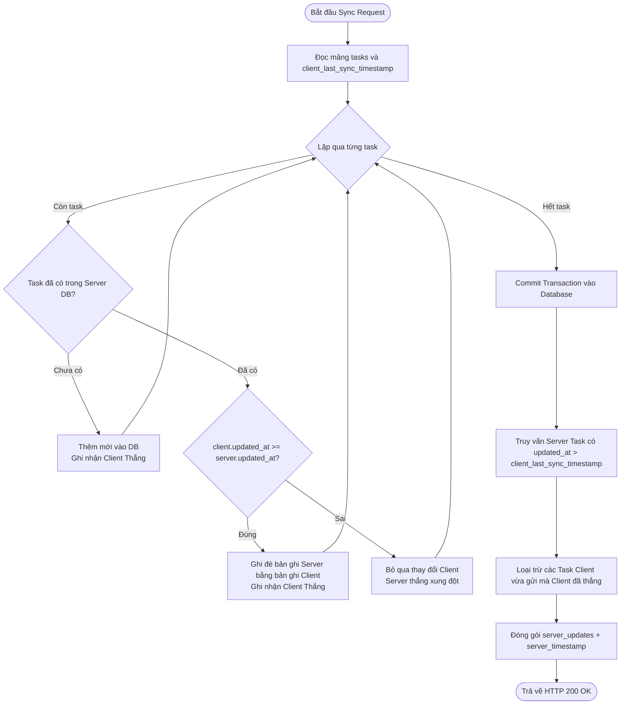

# 📘 D5: THUẬT TOÁN ĐỒNG BỘ HAI CHIỀU & PHÂN GIẢI XUNG ĐỘT (LWW)
**Đề tài:** Ứng dụng Android Offline-First với Two-Way Sync Engine  
**Người phụ trách:** Thành viên B (Backend & Sync Engine Lead)  

---

## 1. NGUYÊN LÝ THUẬT TOÁN LAST-WRITE-WINS (LWW)

Trong mô hình **Offline-First**, thiết bị Client có thể chỉnh sửa dữ liệu khi không có mạng trong nhiều giờ hoặc nhiều ngày. Khi kết nối Internet được thiết lập lại:
1. Nhiều thiết bị có thể cùng chỉnh sửa một bản ghi Task $T$.
2. Để thống nhất trạng thái cuối cùng mà không cần tương tác thủ công từ người dùng, hệ thống sử dụng trường `updated_at` (Unix epoch tính bằng milliseconds).
3. **Quy tắc phán quyết:** Bản ghi nào có mốc thời gian `updated_at` lớn hơn (được chỉnh sửa sau cùng) sẽ **chiến thắng** và trở thành dữ liệu chuẩn.

---

## 2. LƯU ĐỒ THUẬT TOÁN ĐỒNG BỘ PHÍA SERVER (PUSH & PULL)

Khi Client gọi `POST /api/v1/tasks/sync`:

---

## 3. CÁC TÌNH HUỐNG KIỂM THỬ THỰC TẾ

1. **Client tạo mới khi Offline:** Server nhận ID UUID v4, thêm mới vào cơ sở dữ liệu.
2. **Client cập nhật task khi Offline:** `client.updated_at` > `server.updated_at` -> Server cập nhật dữ liệu mới.
3. **Hai Client cùng sửa 1 task khi Offline (Xung đột):**
   - Thiết bị A sửa lúc $t_1$, thiết bị B sửa lúc $t_2$ ($t_2 > t_1$).
   - Thiết bị A đồng bộ trước -> Server nhận bản ghi ở $t_1$.
   - Thiết bị B đồng bộ sau -> Do $t_2 > t_1$, Server cập nhật theo bản ghi của Thiết bị B.
   - Khi Thiết bị A đồng bộ lần kế tiếp -> Server gửi bản ghi $t_2$ về cho Thiết bị A cập nhật lại Room DB.
4. **Xóa mềm (Soft Delete):** Task bị xóa có `is_deleted = true`. Thuật toán LWW xử lý cờ này như một bản cập nhật thông thường, lan truyền trạng thái xóa sang các Client khác mà không gây mất dấu lịch sử.
